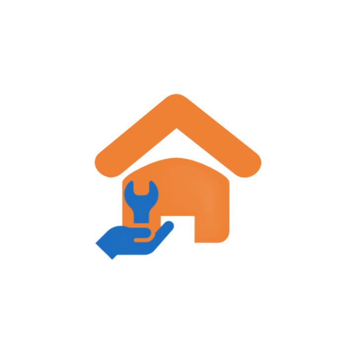
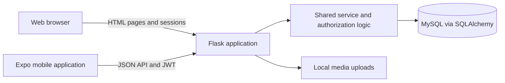

# UpKeep

<p align="center">
  
</p>

<p align="center"><strong>Home and facility maintenance, connected through one platform.</strong></p>
<p align="center">Flask · MySQL · React Native · Expo · TypeScript · Arabic & English</p>

UpKeep is a web and mobile application for managing maintenance services from the initial customer request through technician selection, service delivery, invoicing, and customer feedback. It brings customers, technicians, and administrators into a shared workflow, making service information and job progress easier to follow.

## Academic background

This application is my graduation project at **Arab Private University for Science and Technology**, submitted in fulfillment of the requirements for a degree in **Information Technology Engineering**.

| Detail | Information |
| --- | --- |
| Project | UpKeep — Maintenance Services Platform |
| Author | [Molham Alkaseer](https://github.com/Molham-Alkaseer) |
| University | Arab Private University for Science and Technology |
| Degree | Information Technology Engineering |
| Graduation project date | 22 June 2026 (22/06/2026) |

## Contents

- [Project objectives](#project-objectives)
- [Features and user roles](#features-and-user-roles)
- [Service workflow](#service-workflow)
- [Architecture and technology](#architecture-and-technology)
- [Repository structure](#repository-structure)
- [Local setup](#local-setup)
- [Damascus mock data](#damascus-mock-data)
- [API overview](#api-overview)
- [Testing](#testing)
- [Project scope](#project-scope)

## Project objectives

UpKeep addresses the coordination involved in arranging home and facility maintenance: describing a problem, finding a suitable technician, comparing offers, and keeping track of the work. The project aims to:

- Centralize service requests and their related offers, invoices, and reviews.
- Help technicians find work relevant to their specialization and location.
- Give customers a clear record of service progress and costs.
- Provide administrators with visibility into users and platform activity.
- Support Arabic and English users through localized interfaces and layout direction handling.

## Features and user roles

| Role | Capabilities |
| --- | --- |
| **Customer** | Create maintenance requests, select a location and preferred schedule, attach supporting media, compare technician offers, track service progress, view invoices, record a simulated payment, and submit ratings. |
| **Technician** | Browse relevant requests, use location and distance information to find nearby work, submit offers, manage assigned jobs, update service progress, and maintain a profile and work portfolio. |
| **Administrator** | Review dashboard statistics, manage users and service specializations, inspect requests and invoices, export invoice records, and review activity logs. |

### Shared capabilities

- **Web and mobile access:** a Flask web application and an Expo mobile client use the same backend and database.
- **Role-based access:** customer, technician, and administrator workflows with authorization checks.
- **Authentication:** session-based login for the web application and JWT bearer tokens for the mobile API, with mobile tokens stored through Expo SecureStore.
- **Arabic and English:** localized text, language preferences, and support for right-to-left interfaces.
- **Location-aware requests:** map selection, coordinate validation, distance calculations, and role-dependent visibility of precise locations.
- **Service history:** request timelines, technician offers, invoice details, and customer ratings.
- **Profiles and media:** profile images, request attachments, and technician portfolio images.

## Service workflow

1. **Request a service.** A customer chooses a maintenance category and provides the problem description, location, preferred schedule, and optional attachment.
2. **Review offers.** Technicians submit offers for relevant requests; the customer chooses an offer.
3. **Start the work.** The assigned technician begins the job, and the request progresses through its service states.
4. **Review the invoice and payment status.** The application records invoice amounts and a simulated payment as part of the demonstration workflow.
5. **Complete and rate.** The technician completes the service after the required payment state is recorded, and the customer can submit a rating and review.

Requests use the states `pending`, `assigned`, `in_progress`, `completed`, and `cancelled`. Timeline entries provide a record of workflow activity.

## Architecture and technology



| Layer | Technologies and responsibilities |
| --- | --- |
| Backend | Python, Flask, Flask-Login, Flask-WTF, Flask-CORS, and PyJWT |
| Database | MySQL, SQLAlchemy ORM, PyMySQL, and Flask-Migrate/Alembic |
| Web interface | Jinja templates, HTML, CSS, and JavaScript |
| Mobile interface | React Native 0.81, React 19, Expo SDK 54, TypeScript, and React Navigation |
| Mobile device features | Expo Location, Image Picker, SecureStore, and React Native Maps |
| Localization | Shared Arabic/English resources, web localization helpers, and i18next/react-i18next on mobile |
| Tests | Python unittest, Jest, and React Native Testing Library |

Backend workflow rules are shared through modules such as `service_request_actions.py`, while `api_v1.py` exposes the mobile API. Uploaded media is stored locally under `static/uploads/` and excluded from version control.

## Repository structure

```text
upkeep-graduation-project/
├── app.py                       # Flask application and web routes
├── admin_routes.py              # Administration routes and reporting
├── api_v1.py                    # Versioned JSON API
├── api_jwt.py                   # API token handling
├── api_service_requests.py      # API request queries and serialization
├── models.py                    # Database models and relationships
├── service_request_actions.py   # Shared service workflow logic
├── geo_utils.py                 # Coordinate validation and distances
├── portfolio_service.py         # Technician portfolio operations
├── web_i18n.py                  # Web localization helpers
├── timeline_messages.py         # Service activity messages
├── locales/                    # Arabic and English translations
├── migrations/                 # Incremental database migrations
├── templates/                  # Web pages and administration views
├── static/                     # Styles, scripts, and images
├── mobile/                     # Expo/React Native application
│   ├── src/                    # Screens, navigation, API, and UI modules
│   ├── assets/                 # Mobile images and icons
│   └── README.md               # Detailed mobile development guidance
├── tests/                      # Backend tests
├── seed_demo.py                # Demo data loader and reset options
├── seed_demo_data.py           # Fictional demonstration fixtures
├── requirements.txt           # Backend dependencies
└── .env.example               # Backend configuration template
```

## Local setup

The commands below use **Windows PowerShell**. Run backend commands from the repository root.

### Prerequisites

- Python with `venv` and `pip`; the source uses Python 3.10+ syntax.
- A running MySQL server and an account permitted to create the development schema.
- Node.js and npm for the mobile application; see the [mobile guide](mobile/README.md) for its prerequisites.
- An Expo client compatible with the project's SDK, or a suitable emulator/development build.
- Git. The MySQL `mysqldump` utility is also needed when replacing an existing demo dataset.

### 1. Clone and install backend dependencies

```powershell
git clone https://github.com/Molham-Alkaseer/upkeep-graduation-project.git
cd upkeep-graduation-project
python -m venv venv
.\venv\Scripts\python.exe -m pip install -r requirements.txt
Copy-Item .env.example .env
```

### 2. Configure the backend

Edit the local `.env` file with your MySQL credentials and an application secret. Replace the example values below with your own settings:

```dotenv
SECRET_KEY=replace-with-a-long-random-secret
DB_USER=your_mysql_user
DB_PASSWORD=your_mysql_password
DB_HOST=localhost
DB_NAME=upkeep_db
FLASK_HOST=0.0.0.0
FLASK_PORT=5000
FLASK_DEBUG=True
JWT_EXPIRATION_DAYS=7
```

The database must exist before creating its tables. In MySQL Workbench or a MySQL client, run:

```sql
CREATE DATABASE IF NOT EXISTS upkeep_db
  CHARACTER SET utf8mb4 COLLATE utf8mb4_unicode_ci;
```

If you choose a different name, use that name in `DB_NAME` as well. Additional CORS and portfolio configuration options are documented in [.env.example](.env.example).

### 3. Initialize a fresh development database

For a **new, empty database**, create the current schema directly from the application models, then record the current migration revision:

```powershell
.\venv\Scripts\python.exe -c "from app import app, db; ctx = app.app_context(); ctx.push(); db.create_all(); ctx.pop()"
.\venv\Scripts\python.exe -m flask --app app db stamp head
```

The migration history contains incremental changes and assumes base tables already exist. Running `db upgrade` alone does not initialize an empty database. Stamping records the revision without applying migrations, so use the sequence above only for a fresh database built from the current models. For an existing installation, back up the database and inspect its schema and migration revision before upgrading.

`db_setup.py` is a legacy reset utility that drops application tables. `db_schema.sql` is an earlier schema reference. Use the model-based procedure above for a new checkout.

### 4. Load the optional demo dataset and start Flask

```powershell
.\venv\Scripts\python.exe seed_demo.py
.\venv\Scripts\python.exe app.py
```

Open **http://127.0.0.1:5000**. The health endpoint at **http://127.0.0.1:5000/api/v1/health** returns a JSON status response. Demo credentials and reset behavior are described below.

### 5. Start the mobile application

Keep Flask running and open a second terminal:

```powershell
cd mobile
npm ci
Copy-Item .env.example .env
```

Set `EXPO_PUBLIC_API_URL` in `mobile/.env` to an address that reaches the backend:

| Client | Backend URL |
| --- | --- |
| Physical phone on the same Wi-Fi | `http://<YOUR_PC_LAN_IP>:5000` |
| Android emulator | `http://10.0.2.2:5000` |
| iOS Simulator on a Mac running Flask | `http://127.0.0.1:5000` |
| Android connected through configured USB port forwarding | `http://127.0.0.1:5000` |

Then start Expo:

```powershell
npm start
```

Restart Expo after changing environment variables. On a physical phone, `127.0.0.1` refers to the phone unless USB forwarding is configured. See the [mobile README](mobile/README.md) for USB scripts, network troubleshooting, map configuration, and the `FORCE_RTL_DEMO` layout setting in `mobile/index.ts`.

## Damascus mock data

`seed_demo.py` loads a fictional Damascus dataset shared by the web and mobile apps:

- 1 administrator, 6 customers and 8 technicians with Arabic/English names.
- 4 trades: electrical, plumbing, carpentry and air conditioning.
- 34 requests: 8 pending, 4 assigned, 4 in progress, 16 completed and 2 cancelled.
- 58 offers, 24 invoices/payments and 14 reviews, with chronological activity timelines.
- Fictional addresses in six Damascus neighbourhoods, approximate map pins and illustrative SYP prices. Tax uses the app's configured `DEFAULT_TAX_RATE`; this dataset does not represent market prices or tax advice.

Use the project's Python environment after configuring MySQL and initializing the schema as described above:

```powershell
# Replace ALL local application records. A real SQL backup is mandatory and automatic.
.\venv\Scripts\python.exe seed_demo.py --reset-all

# Load into a fresh database, or do nothing if this dataset is already installed.
.\venv\Scripts\python.exe seed_demo.py

# Refresh demo accounts and replace their customers' requests/technician portfolios.
# Other customers' requests and non-demo accounts are retained.
.\venv\Scripts\python.exe seed_demo.py --reset-demo
```

Replacement requires `mysqldump` on PATH and a local MySQL database using InnoDB. Backups are saved as `backup_before_mock_<timestamp>.sql` in the project directory and ignored by Git. Failed backups abort replacement; failed inserts roll back the replacement transaction. Existing schema, migration history and uploaded files are kept. Old uploads are not reused in the fictional dataset. Request and account IDs continue increasing.

Restore a backup with MySQL Workbench's **Server → Data Import → Import from Self-Contained File**, selecting the backup and the original database. The backup includes table definitions and data. The app's administrative backup/restore pages are legacy placeholders and should not be used for this recovery.

All demo accounts use password **`Demo1234`**. Sign out of existing web/mobile sessions and sign in with a new account:

| Role | Email | Name |
| --- | --- | --- |
| Administrator | `admin.demo@upkeep.local` | Salim Murad |
| Main customer | `customer.demo@upkeep.local` | Rami Al Khatib |
| Customer | `customer.sara@upkeep.local` | Sara Mansour |
| Customer | `customer.omar@upkeep.local` | Omar Al Hassan |
| Customer | `customer.nour@upkeep.local` | Nour Haddad |
| Customer | `customer.yara@upkeep.local` | Yara Darwish |
| Customer | `customer.karim@upkeep.local` | Karim Nasser |
| Electrician | `tech.ahmad@upkeep.local` | Ahmad Hammoud |
| Electrician | `tech.lina@upkeep.local` | Lina Abbas |
| Plumber | `tech.samer@upkeep.local` | Samer Youssef |
| Plumber | `tech.hala@upkeep.local` | Hala Mustafa |
| Carpenter | `tech.fadi@upkeep.local` | Fadi Suleiman |
| Carpenter | `tech.roula@upkeep.local` | Roula Saleh |
| AC technician | `tech.mazen@upkeep.local` | Mazen Ibrahim |
| AC technician | `tech.dima@upkeep.local` | Dima Murad |

The main customer can compare competing offers, start an assigned electrical job with Ahmad, pay for work in progress, and rate a completed job. Some pending requests have no offers yet, and two paid jobs await technician completion. For nearby-job testing, place the device near **33.5008, 36.2526** (Mezzeh, Damascus). Dates are relative to the time of seeding; rerun `--reset-demo` to refresh them. Edit `seed_demo_data.py` to customize names, job descriptions and prices.

## API overview

The mobile application communicates with the backend through **`/api/v1`**. After signing in, include the returned token in authenticated requests:

```http
Authorization: Bearer <access_token>
```

Representative routes are listed below. Request bodies and role restrictions are defined in `api_v1.py` and the shared service modules.

| Method | Endpoint | Purpose |
| --- | --- | --- |
| `GET` | `/api/v1/health` | Check backend availability |
| `POST` | `/api/v1/auth/register` | Register an account |
| `POST` | `/api/v1/auth/login` | Sign in and obtain an access token |
| `GET`, `PATCH` | `/api/v1/me` | Read or update the current profile |
| `GET` | `/api/v1/specializations` | List service categories |
| `GET`, `POST` | `/api/v1/requests` | List accessible requests or create a request |
| `GET` | `/api/v1/requests/<request_id>` | Read request details |
| `POST`, `PUT`, `PATCH` | `/api/v1/requests/<request_id>/offers` | Submit or update a technician offer |
| `POST` | `/api/v1/offers/<offer_id>/choose` | Choose a technician's offer |
| `POST` | `/api/v1/requests/<request_id>/accept` | Start an assigned job |
| `POST` | `/api/v1/requests/<request_id>/pay` | Record a simulated payment |
| `POST` | `/api/v1/requests/<request_id>/complete` | Complete a service request |
| `POST` | `/api/v1/requests/<request_id>/rating` | Submit a customer rating |
| `GET`, `POST` | `/api/v1/me/portfolio` | List or add technician portfolio items |

## Testing

Backend tests cover coordinate validation, distance filtering, location visibility, request creation, and demo workflow consistency. Run individual suites from the repository root, for example:

```powershell
.\venv\Scripts\python.exe -m unittest discover -s tests -p "test_geo_utils.py"
.\venv\Scripts\python.exe -m unittest discover -s tests -p "test_api_request_geo.py"
.\venv\Scripts\python.exe -m unittest discover -s tests -p "test_seed_demo.py"
```

`test_seed_demo.py` uses an isolated SQLite database. The separate `test_demo_geo_verification.py` integration suite expects a configured local MySQL database with the demonstration data.

Run mobile tests and the TypeScript check from `mobile/`:

```powershell
npm test
npx tsc --noEmit
```

Mobile tests include localization, location handling, request display, and screen rendering.

## Project scope

UpKeep is an academic application and a portfolio project. The repository demonstrates service coordination across a web interface, a mobile client, and a shared backend.

- **Payments are simulated.** The current workflow updates payment and invoice records without charging a card or integrating with an external payment gateway.
- **Media storage is local.** User uploads, local configuration, database backups, and installed dependencies are excluded from Git. A new checkout does not include existing user data or media.
- **Demo accounts are for local evaluation.** Their published passwords and fictional records are intended for demonstrations. Deployment requires separate credentials, a unique secret, disabled Flask debug mode, and a production server configuration.
- **Administrative backup tooling is incomplete.** Use the demo loader's actual MySQL backup mechanism or standard MySQL tools when safeguarding development data.

For questions or project discussion, use [GitHub Issues](https://github.com/Molham-Alkaseer/upkeep-graduation-project/issues).
